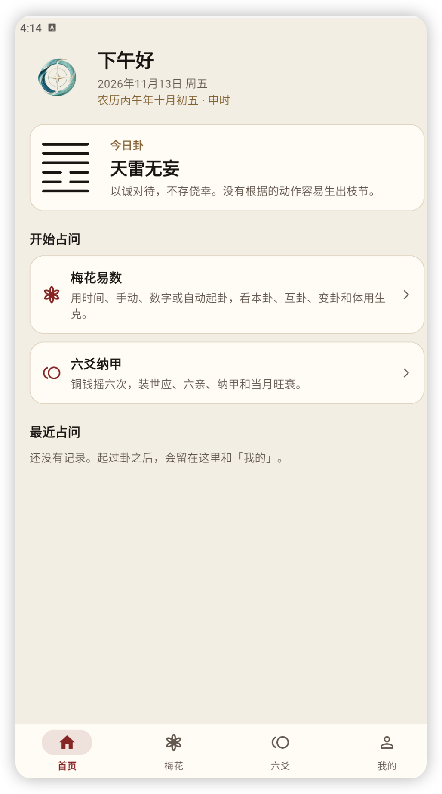
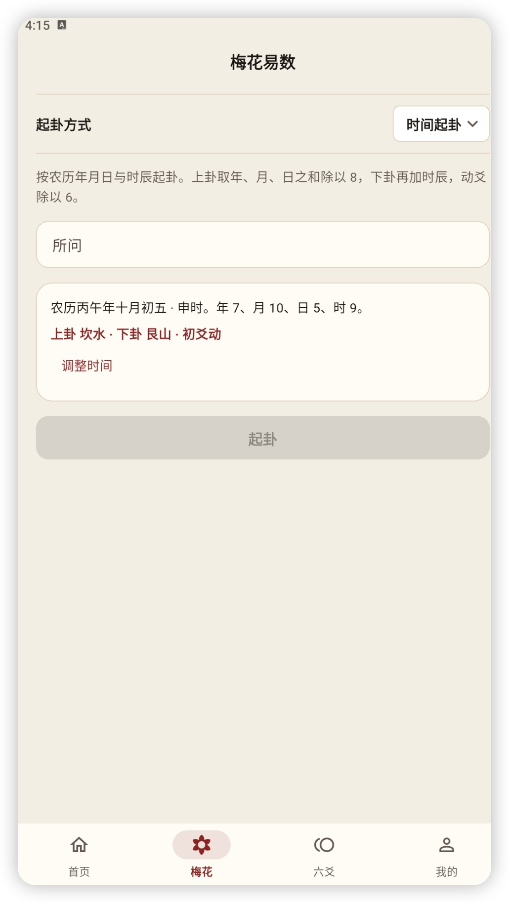
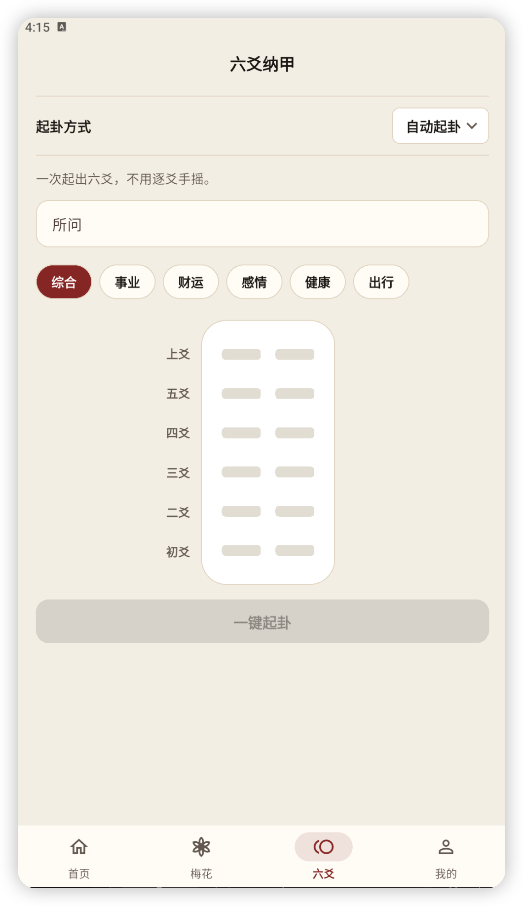
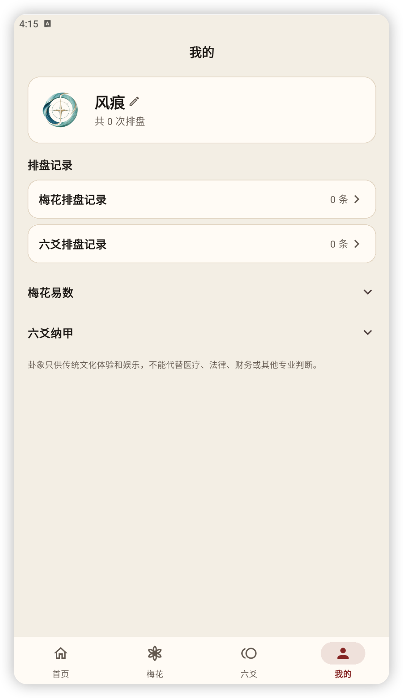

# 风痕

梅花易数与六爻纳甲。按农历看今日卦，起卦后排本卦、互卦、变卦，或装世应、六亲、纳甲和月令旺衰。记录留在本机。

<p align="center">
  
  
  
  
</p>

## 首页

按时间问好，并显示公历、农历和今日卦。从这里进入梅花或六爻。起过的卦会出现在最近占问里。

## 梅花易数

用先天八卦数起卦，支持四种方式：

- 时间起卦：按农历年月日与时辰
- 手动指定：自己选上卦、下卦和动爻
- 数字起卦：数字起卦 1 报一组数字，数字起卦 2 报一个三位数
- 自动起卦

成卦后看本卦、互卦、变卦，再以不动的一卦为体、发动的一卦为用，看五行生克。

## 六爻纳甲

三枚铜钱摇六次，从初爻装到上爻。背为阳、字为阴：一背二字为少阳，两背一字为少阴，三背为老阳，三字为老阴。老阳、老阴是变爻。

可以自己逐爻摇，也可以手动指定、一次起出六爻，或按时间、数字起卦。装好世应、纳甲、六亲、六神和当月旺衰。

## 我的

可以改名字和头像，查看梅花、六爻的排盘记录，并阅读两种起卦方式的说明。

卦象只供传统文化体验和娱乐，不能代替医疗、法律、财务或其他专业判断。

## 运行

```bash
flutter pub get
flutter run
```
